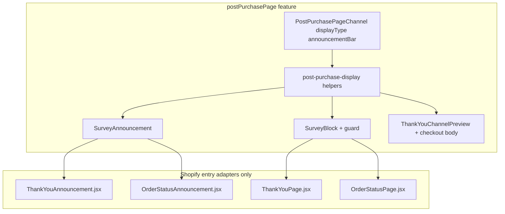

# Announcement bar display type (`postPurchasePage` only)

## Product scope (decision)

**Announcement bar applies only to [`postPurchasePage`](app/lib/survey/types.ts)** (Thank you + Order status via checkout UI extension). No other channel in the roadmap needs block vs announcement:

| Channel | Display modes (this project) |
|---------|------------------------------|
| `postPurchasePage` | `blockType` \| `announcementBarType` |
| `dedicatedPageSurvey`, `siteWidget`, email, POS, etc. | Own UX — **no** announcement bar |

So we **do not** add a global channel capabilities registry or generic `ChannelDisplayTypeSettings` used by every channel. Keep [`PostPurchaseAdvancedSettings`](app/components/survey-editor/RightPanel/Channel/PostPurchaseAdvancedSettings.tsx) and [`ChannelInspector`](app/components/survey-editor/RightPanel/ChannelInspector.tsx) routing as today (`selectedChannelKey === "postPurchasePage"`).

**What stays “shared” (within post-purchase only):** small helpers + UI pieces so thank-you and order-status **surfaces** are not copy-pasted — that is Shopify’s two targets, not “many channels.”

## Goals

1. **Runtime:** For surveys on `postPurchasePage`, honor `displayType` — announcement → Shopify announcement targets + modal survey; block (or missing field) → existing block targets.
2. **Editor preview:** Changing **Display type** in post-purchase advanced settings **immediately** updates the center canvas (bar + modal vs inline block), matching competitor UX.
3. **Stability:** Default `blockType`; block path unchanged for existing merchants and documents.

## Non-breaking guarantees

| Area | Rule |
|------|------|
| Default | `displayType` omitted → **`blockType`** |
| Block runtime / preview | Unchanged when not `announcementBarType` |
| Other channels | Inspectors and previews untouched |
| Publish / API | No migration; payload already includes `postPurchasePage` fields |
| Tests | `npm run typecheck` + `npm run test` green |

---

## Platform model (two Shopify surfaces)

| Surface | Block target | Announcement target |
|---------|--------------|---------------------|
| Thank you | `purchase.thank-you.block.render` | `purchase.thank-you.announcement.render` |
| Order status | `customer-account.order-status.block.render` | `customer-account.order-status.announcement.render` |

UX: [Announcement bar guidelines](https://shopify.dev/docs/apps/build/checkout/thank-you-order-status/ux-for-announcement-bar).

---

## 1. Types and helpers (post-purchase scoped)

**Types:** Keep `displayType` and `announcementBar` on **`PostPurchasePageChannel`** only (already in [`types.ts`](app/lib/survey/types.ts)). No new cross-channel interface required.

**App helpers** — e.g. [`app/lib/survey/post-purchase-display.ts`](app/lib/survey/post-purchase-display.ts):

- `DEFAULT_POST_PURCHASE_DISPLAY_TYPE = 'blockType'`
- `postPurchaseDisplayType(channel: PostPurchasePageChannel | undefined)`
- `isPostPurchaseAnnouncementBar(channel)`
- `resolvePostPurchaseAnnouncementCopy(channel, surveyName)` — fallbacks + limits from [`postPurchaseAnnouncementLimits.ts`](app/components/survey-editor/RightPanel/Channel/postPurchaseAnnouncementLimits.ts)

**Extension helpers** — e.g. [`extensions/thank-you-survey/src/survey/post-purchase-display.js`](extensions/thank-you-survey/src/survey/post-purchase-display.js):

- Read from `survey.channels[CHECKOUT_CHANNEL_KEY]` ([`channel-config.js`](extensions/thank-you-survey/src/channel-config.js)) — this extension only ever delivers `postPurchasePage`.
- `shouldRenderPostPurchaseBlock(survey)` / `shouldRenderPostPurchaseAnnouncement(survey)`

Optional: keep thin wrappers in [`checkout-data.js`](extensions/thank-you-survey/src/survey/checkout-data.js) that delegate to the above for backward compatibility with `channelDisplayType(survey, channelKey)`.

**Do not** extend [`channels.ts`](app/lib/survey/channels.ts) with `displayModes` unless a second channel later needs announcement (YAGNI).

---

## 2. Checkout extension

### TOML

Add two announcement targets in [`shopify.extension.toml`](extensions/thank-you-survey/shopify.extension.toml); restart `shopify app dev`.

### Entry modules

- **Block entries:** if `shouldRenderPostPurchaseAnnouncement(survey)` → `null`; else existing `SurveyBlock`.
- **Announcement entries:** inverse guard → `SurveyAnnouncement` with distinct `modalId` per surface (thank-you vs order-status).

### `SurveyAnnouncement`

- Copy from `announcementBar` via post-purchase helpers.
- `<s-announcement>` + CTA opening `<s-modal>`; body = `<SurveyBlock shell="plain" ... />` (default `shell="card"` elsewhere).

Validate with Shopify skill (`2026-07`) per announcement target.

---

## 3. Editor preview — live switch (post-purchase canvas only)

Pass **`PostPurchasePageChannel`** (or full `survey.channels.postPurchasePage`) from [`SurveyEditorChrome`](app/components/survey-editor/SurveyEditorChrome.tsx) → [`EditorPreview`](app/components/survey-editor/EditorPreview.tsx) when `channelKey === 'postPurchasePage'`.

Extend [`EditorPreviewFrameProps`](app/components/survey-editor/preview/types.ts) with optional `postPurchaseChannel?: PostPurchasePageChannel`.

**Behavior:** `postPurchaseDisplayType(channel)` drives layout in [`ThankYouCheckoutBody`](app/components/survey-editor/preview/channels/thank-you/ThankYouCheckoutBody.tsx) (and parent preview):

- **`blockType`:** current inline `SurveyPreviewStep` (no regression).
- **`announcementBarType`:** bar strip above store header + Polaris `Modal` for questions; hide inline block; CTA opens modal; copy fields update live.

Colocate preview-only components under e.g. `preview/channels/thank-you/post-purchase/` (`AnnouncementBarPreviewStrip`, modal wrapper) — **not** a global `preview/display/` framework for all channels.

Other channel previews ignore `postPurchaseChannel`.

---

## 4. Right panel (minimal change)

- Keep **[`PostPurchaseAdvancedSettings`](app/components/survey-editor/RightPanel/Channel/PostPurchaseAdvancedSettings.tsx)** as the home for Display type + announcement fields (use shared helpers for copy resolution in preview if useful).
- Update **[`PostPurchaseDisplaySettingCard`](app/components/survey-editor/RightPanel/Channel/PostPurchaseDisplaySettingCard.tsx)** only: `displayType` prop → “Add block” vs announcement placement guidance (checkout editor links unchanged).

No rename to generic `ChannelPlacementSettingCard` in this iteration.

---

## 5. Verification checklist

**Automated:** `npm run typecheck`, `npm run test`; optional tests for `post-purchase-display.ts`.

**Editor:** Block preview unchanged; toggle announcement → bar + modal; toggle back; mobile/desktop.

**Extension:** Publish both display types; thank-you + order-status; no double UI when block slot still placed.

---

## File touch list

| Action | Path |
|--------|------|
| Add | `app/lib/survey/post-purchase-display.ts` (+ tests) |
| Add | `extensions/.../post-purchase-display.js`, `SurveyAnnouncement.jsx`, `*Announcement.jsx` |
| Edit | `shopify.extension.toml`, block entries, `SurveyBlock.jsx`, `shared.jsx`, locales |
| Edit | `SurveyEditorChrome.tsx`, `EditorPreview.tsx`, `preview/types.ts`, `ThankYouChannelPreview.tsx`, `ThankYouCheckoutBody.tsx` |
| Edit | `PostPurchaseDisplaySettingCard.tsx` (+ `displayType` from advanced settings) |

**Explicitly out of scope:** announcement bar for non–post-purchase channels; `channels.ts` capabilities registry; refactoring `ChannelInspector` beyond passing channel into preview.
