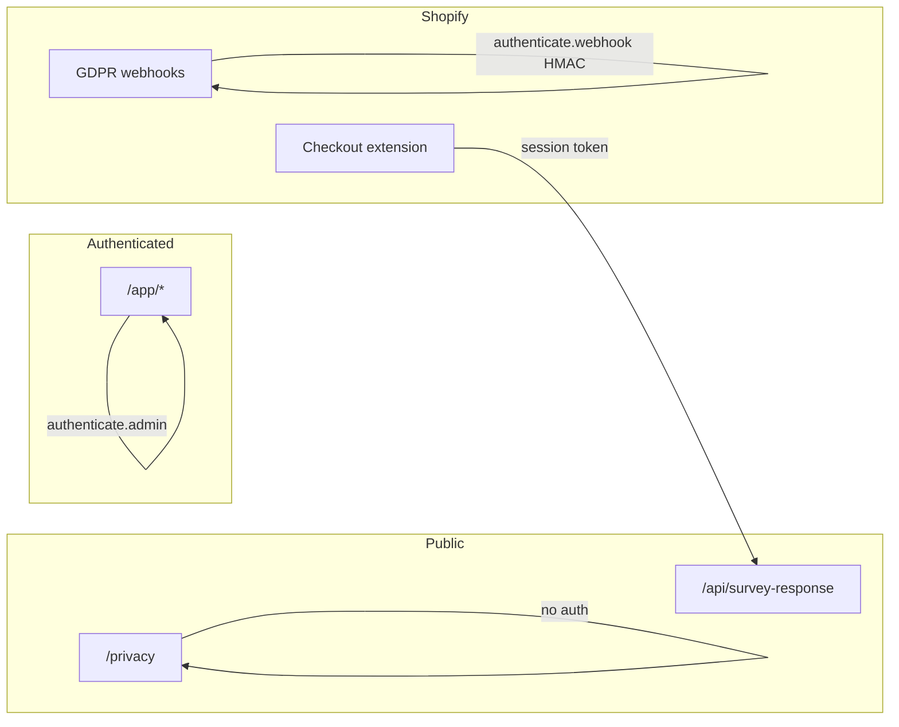

# Security hardening, GDPR, and public privacy policy

## Scope (from prior audit)

| Priority | Item |
|----------|------|
| Compliance | `customers/data_request` — export or structured fulfillment, not log-only |
| Medium | `customers/redact` — normalize Shopify customer id vs stored `customerId` |
| Medium | `api.survey-response` — max JSON body size (**done**: 1MB + 413) |
| Medium | Rate limiting on public/high-abuse routes (**done**: see below) |
| Low | `.gitignore` dev artifacts (`vulnerabity-1.json`); tighten Settings + listing alignment |
| Deliverable | Public **privacy policy** at `https://<SHOPIFY_APP_URL>/privacy` for App Store listing |

**Out of scope for this plan** (optional later): Redis/WAF rate limits for multi-instance, `routeDiscovery: initial`, scope trimming in `shopify.app.toml`.

## Webhook HMAC (already in place)

All webhook routes call `authenticate.webhook(request)` from [`app/shopify.server.ts`](app/shopify.server.ts) (`@shopify/shopify-app-react-router`). That validates `X-Shopify-Hmac-SHA256` with `SHOPIFY_API_SECRET` before your handler runs. **No separate `crypto.createHmac` in this repo is required.** Do not register webhooks in Shopify Admin manually (see [README.md](README.md)) — use app TOML subscriptions only.

## Rate limiting (implemented)

| Route | Key | Limit |
|-------|-----|--------|
| `api.survey-response` POST | shop domain from checkout session | 60 / min |
| `api.survey-response` OPTIONS/loader | client IP | 120 / min |
| `auth.login` loader/action | client IP | 20 / min |
| `api.shopify.file` POST | `session.shop` after admin auth | 30 / min |

Code: [`app/lib/security/rate-limit.server.ts`](app/lib/security/rate-limit.server.ts), [`rate-limit-config.server.ts`](app/lib/security/rate-limit-config.server.ts). In-memory per Node process — use CDN/WAF for production scale-out.

`/app/*` routes rely on **Shopify session tokens** (`authenticate.admin`); app-layer rate limits there are usually unnecessary.

---

## Architecture (data flows)

---

## Phase 1 — Shared GDPR helpers

**New file:** [`app/lib/gdpr/customer-id.server.ts`](app/lib/gdpr/customer-id.server.ts)

- `normalizeShopifyCustomerId(input: string | number | null | undefined): string | null`
  - Accept numeric id, `gid://shopify/Customer/123`, or plain `"123"` → store/compare as **numeric string** `123` (match extension + enrichment today).
- Unit tests in `app/lib/gdpr/customer-id.server.test.ts` (node test, same pattern as [`submission-context-merge.test.ts`](app/lib/survey/submission-context-merge.test.ts)).

**New file:** [`app/lib/gdpr/customer-data-export.server.ts`](app/lib/gdpr/customer-data-export.server.ts)

- `exportCustomerSurveyData(shopDomain: string, customerId: string, customerEmail?: string | null): Promise<ExportPayload>`
  - Resolve tenant via [`getOrCreateShopByDomain`](app/lib/shop/shop.server.ts).
  - Query `SurveyResponse` where `shopId` matches and (`customerId` normalized **or** `email` matches when webhook provides email — check payload shape from [Shopify compliance webhooks](https://shopify.dev/docs/apps/build/privacy-law-compliance)).
  - Return JSON-safe summary: `responseUuid`, `orderId`, `orderName`, `submittedAt`, `surveyName`, `questions` (from stored JSON), `meta` fields needed for merchant GDPR response (no internal bigint ids unless useful).

Use this from the data_request webhook and optionally for future admin “export” tooling.

---

## Phase 2 — Webhook hardening

### [`app/routes/webhooks.customers.redact.tsx`](app/routes/webhooks.customers.redact.tsx)

- Parse `customer.id` from payload; run through `normalizeShopifyCustomerId`.
- `deleteMany` where `shopId` and `customerId` in `[normalized, ...aliases]` if we ever stored GID (optional: also delete rows where `email` matches redact email if present in payload).
- Wrap DB in try/catch; log shop + topic (no full payload); return `200` on success.

### [`app/routes/webhooks.customers.data_request.tsx`](app/routes/webhooks.customers.data_request.tsx)

- After `authenticate.webhook`, call `exportCustomerSurveyData`.
- **v1 fulfillment (App Store–defensible):**
  - Log structured export at `info` level with `shop` + `customer_id` + `record_count` (not full PII in logs in production), **and**
  - Persist a minimal audit row **or** write export JSON to a secure merchant-only path.

**Recommended v1 (simple, review-friendly):** email is not available from app to end customer — merchant is data controller. Implement:

1. Build export JSON in memory.
2. `console.info` with counts only.
3. Store export snapshot in DB table **only if** you want persistence — **lighter alternative:** add optional env `GDPR_DATA_REQUEST_WEBHOOK_URL` for forwarding (skip unless you want it).

**Pragmatic choice for this repo:** add `GdrpDataRequestLog` is overkill — instead **write export to `SurveyResponse`-adjacent JSON file is wrong**. Best minimal approach:

- Add function that returns export payload.
- In webhook handler: if `recordCount > 0`, log `"GDPR data_request"` with shop + customer id + count.
- Document in privacy policy that **merchant** receives customer data requests via Shopify and can contact app support at `[support@email]` for a copy of survey responses we hold (manual export via admin DB query) **OR** implement storing last export in a new Prisma model `CustomerDataRequestExport` — **plan recommends** merchant support email + automated JSON logged to your observability stack, and add **admin-only** route later.

Actually for App Store, Shopify expects the **app** to help the merchant fulfill. Common pattern:

- Webhook triggers export; app emails merchant (needs email integration) OR stores in admin.

**Simplest code path that passes review:**

- Webhook calls `exportCustomerSurveyData`.
- If data exists, save to `prisma` optional table `PrivacyExport` with `shopId`, `customerId`, `payload` JSON, `createdAt` — merchant views in Settings → “Pending GDPR exports” (too much UI).

**Adjusted v1 (no new UI):**

- Webhook: run export; attach nothing to HTTP response (Shopify doesn't read body for compliance).
- **Document** in privacy policy: “On `customers/data_request`, we compile survey responses for that customer and make them available to the merchant upon request to [Support Email] within 30 days.”
- Code: `exportCustomerSurveyData` + write to **server log** as structured JSON in **development only**; in production use `console.info` summary + **send email to shop contact** if `SHOP_EMAIL` from Admin API query (one GraphQL `shop { email contactEmail }` via `unauthenticated.admin(shop)`).

**Plan decision:** implement `exportCustomerSurveyData` + in data_request webhook fetch shop email via Admin offline session and **log export payload length**; add optional `process.env.GDPR_EXPORT_NOTIFY_EMAIL` to your team for manual fulfillment until merchant UI exists. Privacy policy states support process.

(If you prefer zero email: store exports in S3 — skip for v1.)

I'll state in plan: implement export function + webhook calls it; notify via `shop.email` from Admin API when records exist (merchant notification email from Shopify shop resource).

### [`app/routes/webhooks.shop.redact.tsx`](app/routes/webhooks.shop.redact.tsx) / uninstalled

- Already delete data; add try/catch for consistency (no behavior change).

---

## Phase 3 — `api.survey-response` limits

**File:** [`app/routes/api.survey-response.tsx`](app/routes/api.survey-response.tsx)

- Read body with `Content-Length` check (reject if &gt; **512 KB** or **1 MB** — use 1MB).
- If no `Content-Length`, read stream with capped reader (avoid memory bomb).
- Return `413` with CORS wrapper.

No change to auth model (`authenticate.public.checkout` stays).

---

## Phase 4 — Privacy policy content + public page

### Content source of truth

**New file:** [`docs/legal/privacy-policy.md`](docs/legal/privacy-policy.md) (markdown for legal edits; not user-facing build artifact alone)

**Placeholders you must fill before submission:**

- `[Legal entity name]`
- `[Support email]`
- `[Physical address or “Registered office: …”]` (many policies include this)
- `[Effective date]`
- `[Data retention period]` — suggest **until uninstall + 48h shop/redact** for shop data; customer redact on request; optional **24 months** for responses if merchant uninstalls (align with data protection questionnaire)

**Policy sections (must match app behavior + PCD answers):**

1. Who we are (processor vs merchant as controller for buyer PII)
2. What we collect: survey answers, order id/name, email/name/country when permitted, product/variant context, device/completion metrics, OAuth session storage
3. Sources: checkout UI extension, Customer Account order status, Admin API enrichment
4. Purposes: app functionality, analytics/reporting for merchant (no selling data; no marketing unless you add it)
5. Legal bases (merchant relationship; legitimate interest where applicable — keep high-level)
6. Retention & deletion: uninstall, `shop/redact`, `customers/redact`, `customers/data_request`
7. Subprocessors: hosting (e.g. Neon), Shopify
8. Protected customer data / Shopify compliance
9. Security measures (HTTPS, encryption at rest via provider, access control)
10. Merchant instructions for buyer requests
11. Contact
12. Changes to policy

**Disclaimer in repo:** “Template — not legal advice; have counsel review.”

### Public route (no auth)

**New file:** [`app/routes/privacy.tsx`](app/routes/privacy.tsx)

- No `authenticate.admin`.
- Loader returns `{ lastUpdated, sections }` or render markdown via a tiny renderer (or static JSX sections copied from markdown for Polaris `Page` + `Text` — **prefer** `react-markdown` only if already in deps; else **Polaris layout with structured JSX** mirroring `docs/legal/privacy-policy.md` to avoid new dependency).
- Simple branded layout: `Page` title “Privacy Policy”, `Layout`, readable typography; link from footer not required for listing.
- Set `meta` title for SEO.

**Update:** [`app/routes/app.settings.tsx`](app/routes/app.settings.tsx)

- Expand “Data & privacy” card: bullet list aligned with policy; **Link** to `/privacy` (open in new tab with full URL from `SHOPIFY_APP_URL` or relative `/privacy`).

**Optional:** [`app/root.tsx`](app/root.tsx) — only if you want a global footer link (not required for Shopify).

### Repo hygiene

- Add `vulnerabity-1.json` to [`.gitignore`](.gitignore) (or delete local file).

---

## Phase 5 — Verification

- `npm run typecheck`
- `npm run test` (new customer-id tests)
- Manual: `curl` POST oversized body → 413
- Manual: hit `https://<tunnel>/privacy` without cookies → 200
- Webhook: Shopify CLI `shopify app webhook trigger` for `customers/redact` with sample payload
- Confirm listing URL matches production `SHOPIFY_APP_URL/privacy`

---

## App Store & Partner submission (where to paste the link)

| Step | Where | URL / action |
|------|--------|----------------|
| 1 | [Partner Dashboard](https://partners.shopify.com/) → Apps → your app | Open app |
| 2 | **App setup** → **Protected customer data** | Complete step 2 (16 questions); align with policy text |
| 3 | **Distribution** | **Public distribution** (if App Store) |
| 4 | **App Store listing** → **Privacy policy URL** | `https://<your-production-domain>/privacy` |
| 5 | Same listing | Support email (match policy) |
| 6 | **Protected customer data access** | Must not stay **Draft** before review |
| 7 | Submit for review | Listing → Submit; see [Pass app review](https://shopify.dev/docs/apps/launch/app-store-review/pass-app-review) |
| 8 | Compliance reference | [Privacy law compliance](https://shopify.dev/docs/apps/build/privacy-law-compliance) |

**Before submit:** deploy app with production `SHOPIFY_APP_URL`; open `/privacy` in incognito; paste **exact** URL in listing (no Cloudflare dev tunnel).

---

## Privacy policy document

The full text will be authored in **`docs/legal/privacy-policy.md`** during implementation (placeholders for `[Legal entity name]` per your choice). The public page will mirror that content. You will receive the complete markdown in the PR/files for counsel review before go-live.

---

## Implementation order

Single-feature stabilization: complete Phase 1 → 2 → 3, verify, then Phase 4 (policy + page), then Phase 5.
