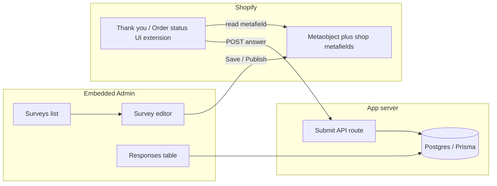

# Shopify App Store approval path (v1)

You chose **checkout-only** surface and **required working Responses**. This plan matches the repo today: strong editor/channel UI, but **mock admin data**, **no submit API**, **no GDPR webhooks**, and **8 channel rows** most reviewers should not see yet.

---

## V1 product contract (listing + reviewer script)

**In scope (must work end-to-end):**

| Step | What reviewer sees |
|------|-------------------|
| Install / OAuth | App loads embedded, no crash |
| Surveys | Create or edit survey, open max-modal editor |
| Content | At least single-choice (HDYHAU) question; save dirty state |
| Channel | **Thank you page** only: enable, targeting/recurrence, announcement/block settings as implemented |
| Save | Publishes to Shopify ([`publish-shopify.server.ts`](app/lib/survey/publish-shopify.server.ts), [`publish.ts`](app/lib/survey/publish.ts)) |
| Checkout | Add block on Thank you + Order status; survey renders ([`extensions/thank-you-survey/`](extensions/thank-you-survey/)) |
| Submit | Buyer selects answer + submits |
| Responses | New row appears in [`app.responses.tsx`](app/routes/app.responses.tsx) |

**Explicitly out of v1 (hide from UI + do not mention in listing):** Branded survey page, on-site widget, email, exit intent, embed, POS, Analytics charts, Integrations “Connect” flows.

**Reference:** [Pass app review](https://shopify.dev/docs/apps/launch/app-store-review/pass-app-review), [App requirements checklist](https://shopify.dev/docs/apps/launch/app-requirements-checklist).

---

## Phase 1 — Freeze scope in the codebase (1–2 days)

**Goal:** Reviewers never land on “will appear here” for advertised features.

1. **Channel tab v1 catalog** — Introduce a single source (e.g. `V1_CHANNEL_KEYS = ['postPurchasePage']` in [`channels.ts`](app/lib/survey/channels.ts)) used by [`LeftPanel/Channel/index.tsx`](app/components/survey-editor/LeftPanel/Channel/index.tsx) and [`ChannelInspector.tsx`](app/components/survey-editor/RightPanel/ChannelInspector.tsx). Keep full `CHANNEL_DEFINITIONS` behind a flag for post-approval work.
2. **Nav shell** — In [`app.tsx`](app/routes/app.tsx), for v1 either remove **Analytics** and **Integrations** from `NavMenu`, or replace with a single “Coming soon” page with no fake actions ([`app.integrations.tsx`](app/routes/app.integrations.tsx) currently shows Connect-style UI).
3. **Dashboard honesty** — [`app._index.tsx`](app/routes/app._index.tsx) uses hard-coded metrics; wire to real DB counts or show neutral copy until Phase 3.
4. **Editor entry** — Ensure default selected channel is `postPurchasePage` ([`SurveyEditorChrome.tsx`](app/components/survey-editor/SurveyEditorChrome.tsx)).

**Exit gate:** Manual walk: every nav item either works or is absent; Channel tab shows only Thank you page.

---

## Phase 2 — Survey persistence + publish (core admin loop) (3–5 days)

**Today:** [`app.surveys._index.tsx`](app/routes/app.surveys._index.tsx) mock rows; editor [`createSampleSurvey()`](app/lib/survey/questions.ts) + save only publishes one in-memory document ([`app.surveys.editor.tsx`](app/routes/app.surveys.editor.tsx) action).

1. **Prisma model for v1 documents** — Add something like `Survey { id, shop, name, document Json, status, createdAt, updatedAt }` (shop-scoped). Deprecate or ignore legacy `SurveyConfig` / `SurveyOption` for v1 unless you intentionally keep HDYHAU-only config (not recommended given current editor).
2. **Surveys CRUD** — Loader/action on surveys index: list, create, duplicate, pause/live flag, delete (with metafield cleanup).
3. **Editor load/save** — Edit route loads survey by id from DB; Save writes DB **then** calls existing `publishSurveysToShop` for **all live surveys** on that shop (so checkout metafield stays consistent).
4. **Publish payload** — Extend [`buildPublishedSurveyPayload`](app/lib/survey/publish.ts) only as needed for v1 (e.g. announcement bar fields, side logo if you keep them in Thank you settings); avoid publishing WIP channel keys.
5. **Uninstall cleanup** — [`webhooks.app.uninstalled`](app/routes/webhooks.app.uninstalled.tsx): delete shop surveys/responses (or mark for redaction).

**Exit gate:** Fresh dev store: create survey → save → reload app → survey still there; metafield contains payload.

---

## Phase 3 — Checkout extension: display + submit (3–5 days)

**Today:** [`shared.jsx`](extensions/thank-you-survey/src/shared.jsx) renders first question only; **no submit**; [`shopify.extension.toml`](extensions/thank-you-survey/shopify.extension.toml) has `network_access` commented out.

1. **UX minimum** — Single-choice + optional “Other” if enabled in document; clear submit control; success/thank-you state after submit.
2. **Enable `network_access`** in extension TOML when API exists.
3. **App submit route** — New route (e.g. `app/routes/api.survey-response.tsx` or `routes/webhooks` pattern): accept `shop`, `orderId`, `surveyId`, `answerId`, optional `customText`; validate shop domain + extension auth ([Shopify checkout UI extension fetch / session docs](https://shopify.dev/docs/api/checkout-ui-extensions)).
4. **Idempotency** — Reuse Prisma `@@unique([shop, orderId])` on [`SurveyResponse`](prisma/schema.prisma) or extend schema with `surveyId` + JSON answers column for multi-question later.
5. **Extension reads correct survey** — Today `firstSurvey()` picks first enabled; v1 should pick the survey handle the merchant published (or single live survey per shop).

**Exit gate:** Test order on dev store → submit on Thank you → row in DB → visible in Admin Responses within seconds.

---

## Phase 4 — Responses admin (1–2 days)

1. Replace mock loader in [`app.responses.tsx`](app/routes/app.responses.tsx) with Prisma query (shop-scoped, paginated).
2. Map stored fields to columns: order, survey name, answer label, date (join or denormalize answer text at write time).
3. Empty state when no submissions.

**Exit gate:** Matches Phase 3 submit test.

---

## Phase 5 — Compliance and config hygiene (1–2 days)

**Gaps today:** No `customers/data_request`, `customers/redact`, `shop/redact` in [`shopify.app.toml`](shopify.app.toml); scopes include `write_products` and template **example** metaobjects may confuse review.

1. **Mandatory GDPR webhooks** — Add subscriptions + handlers (even if minimal: acknowledge + delete shop data on redact).
2. **Scopes audit** — Keep: metaobject/metafield scopes needed for publish; drop `write_products` unless a v1 feature uses it.
3. **TOML cleanup** — Remove or hide demo `product.metafields.app.demo_info` and `metaobjects.app.example` if unused.
4. **Privacy / data use** — Settings or listing text: what you store (order id, answer), retention, uninstall behavior ([`app.settings.tsx`](app/routes/app.settings.tsx)).

**Exit gate:** Partner Dashboard webhooks green; scopes match runtime.

---

## Phase 6 — Production deploy + pre-submission QA (2–3 days)

1. **Hosting** — Production `application_url`, OAuth redirect URLs (replace `example.com` placeholders in TOML).
2. **Automated checks** — `npm run typecheck`, lint, extension build, `shopify app deploy` dry run.
3. **Shopify self-review** — Run the CLI/agent self-review from [Pass app review](https://shopify.dev/docs/apps/launch/app-store-review/pass-app-review) against this branch.
4. **Reviewer package** — English screencast (~3–5 min): install → create survey → enable Thank you → save → add checkout block → place test order → submit → open Responses. Written test steps + dev store staff account if needed.

**Exit gate:** Another developer can follow the script without you present.

---

## Phase 7 — Submit listing (parallel, not blocking code)

- App name, icon, categories aligned with **post-purchase survey / attribution**.
- Screenshots only of v1 surfaces (no branded page / 8-channel UI).
- Support email and privacy policy URL.

---

## Post-approval backlog (do not block v1)

Re-enable full [`CHANNEL_DEFINITIONS`](app/lib/survey/channels.ts), branded page publish to `channel_index`, email/widget extensions, Analytics, Integrations, multi-question extension UX, BFS polish.

---

## Risk register (why this order)

| Risk | Mitigation |
|------|------------|
| Reviewer opens hidden channel → placeholder | Phase 1 gating |
| Listing promises responses but mock admin | Phases 3–4 |
| Rejection for missing GDPR | Phase 5 |
| Resubmit loops from broken save/publish | Phase 2 before extension work |
| Scope creep | No new channel UI until v1 tagged in git |

---

## Suggested execution order

Work **sequentially**: Phase 1 → 2 → 3 → 4 → 5 → 6. Phase 7 listing copy can start during Phase 5–6.

Estimated **2–3 weeks** focused (one feature at a time per your stabilization rule), not counting App Store queue time.
