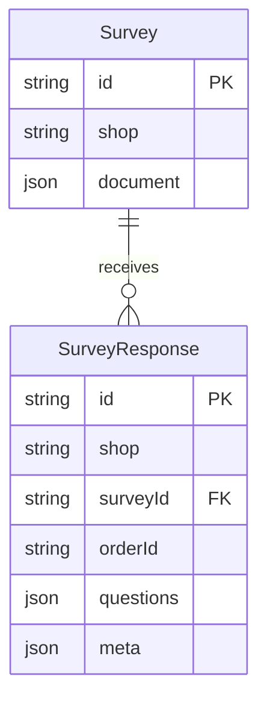
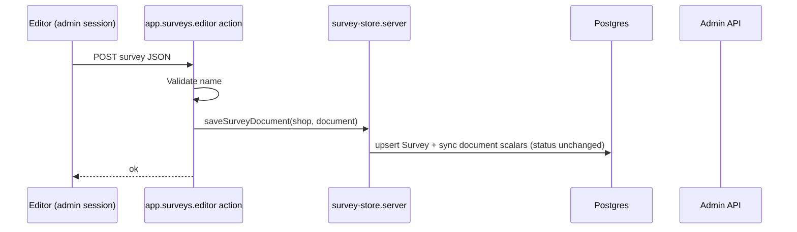
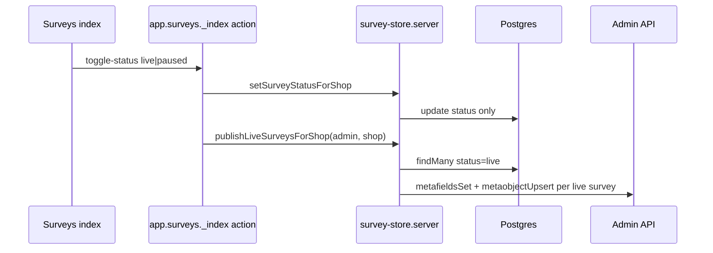

# Survey save & responses — data model and backend design

This is the **backend source of truth** for v1: how survey documents are stored, published to Shopify, and how checkout submissions land in Postgres.

**Code map**

| Layer | Location |
|-------|----------|
| Prisma schema | `prisma/schema.prisma` |
| Survey CRUD + publish | `app/lib/survey/survey-store.server.ts` |
| Response write/read | `app/lib/survey/response/survey-response.server.ts` |
| Competitor-shaped list DTO | `app/lib/survey/response/response-api.mapper.ts` |
| Admin save / list API | `app/lib/survey/admin-api/` |
| Checkout submit HTTP | `app/routes/api.survey-response.tsx` |
| Editor save | `app/routes/app.surveys.editor.tsx` action |
| Surveys list CRUD | `app/routes/app.surveys._index.tsx` loader/action |
| Admin responses | `app/routes/app.responses.tsx` loader |
| Shopify publish | `app/lib/survey/publish-shopify.server.ts` |

Legacy **`SurveyConfig` / `SurveyOption`** were removed; v1 uses **`Survey.document` JSON** plus normalized response tables.

---

## Design principles

1. **Shop tenancy** — Every query filters by `shop` (myshopify.com host from session or checkout token).
2. **Document as source of truth** — The editor’s `SurveyDocument` is stored verbatim in `Survey.document` (JSONB). Scalars (`name`, `surveyType`, `templateType`, `isActive`) sync on save; **`status` (live/paused) is not changed by save**.
3. **Publish is separate from save** — Editor **Save** → Postgres only. Surveys list **Set live / Pause** (or delete) → `publishLiveSurveysForShop` rebuilds Shopify metafields/metaobjects for all **live** rows using each document’s **enabled channels** (any channel key, not hard-coded to thank-you).
4. **One submission per shop + order + survey** — `@@unique([shop, orderId, surveyId])` on `SurveyResponse`; upsert replaces `questions` JSON.
5. **Trust but verify submit** — Checkout extension sends answer ids; server validates against the survey row and stores competitor-shaped `questions` JSON (+ `meta`).

---

## Entity relationship (v1)

---

## `Survey` model

| Field | Purpose |
|-------|---------|
| `id` | Same as `document.id` (editor UUID). Used in publish handle and checkout payload. |
| `shop` | Tenant key. |
| `name` | Display name (also in document). |
| `status` | Prisma enum `live` \| `paused`. Set only via surveys list toggle; controls Shopify publish, independent of channel toggles in the document. |
| `surveyType`, `templateType`, `isActive` | Denormalized from document on save. |
| `document` | Full `SurveyDocument` JSON from editor. |
| `documentVersion` | Future JSON shape migrations. |
| `responseCount` | Optional cache; incremented on first submission per response row. |

**Indexes:** `(shop, status)`, `(shop, updatedAt)`, `(shop, name)`.

### Save flow (merchant)

### Publish flow (live / pause on surveys index)

---

## `SurveyResponse`

Minimal indexed columns + JSON blobs (competitor API shape at read time, not as dozens of SQL columns).

| Field | Purpose |
|-------|---------|
| `shop`, `orderId`, `surveyId` | Unique together; idempotent upsert. |
| `surveyName`, `surveyType` | Snapshot at submit time. |
| `customerId` | GDPR redact webhook + optional filter. |
| `pageType`, `channelType` | Surface filters when needed. |
| `questions` | Competitor `questions[]` JSON (type, question, questionId, answer, answerId, image). |
| `meta` | Order/customer/product/variants/geo/device/displayType — anything from Shopify not queried in SQL yet. |
| `payload` | Optional raw POST for debugging. |
| `submittedAt` | Business time of submission. |

**Delete survey:** blocked by FK `onDelete: Restrict` while responses exist; delete responses first (surveys index delete path).

---

## Write path (checkout)

1. `POST /api/survey-response` — `authenticate.public.checkout`, parse `answers[]` + context fields.
2. `recordSurveySubmission` — transaction: upsert row with `questions` + `meta` JSON; bump `responseCount` on first create.

---

## Read path (admin)

`listSurveyResponsesForShop` loads response rows; `response-api.mapper.ts` merges scalars + `questions` + `meta` into a competitor-style list DTO.

---

## Migrations

Single initial migration: `prisma/migrations/20260325160000_survey_platform`.

- **New database:** `npx prisma migrate deploy` (or `npm run setup`).
- **Development branch with an older interim schema:** use a fresh Neon branch or `npx prisma migrate reset` (destroys data), then `migrate deploy`. If a migration failed mid-way, run `npx prisma migrate resolve --rolled-back "<name>"` before reset or push.

---

## Manual verification (multi-question submit)

1. Save a live survey with 2+ questions in the admin editor.
2. Complete checkout; answer all steps; submit once on the thank-you extension.
3. In Postgres: one `SurveyResponse` row with `questions` JSON array length N.
4. Open **Responses** in admin — summary matches all answers.
