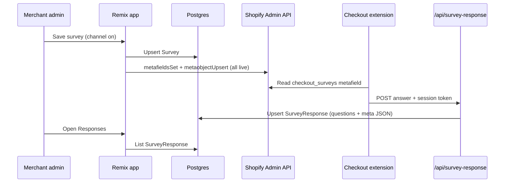

# V1 shipping scope & post-approval roadmap

This document is the **product and engineering source of truth** for what we ship in App Store **v1**, how it works end-to-end, and what we intentionally build **after** approval. It complements the reviewer checklist in [`APP_STORE_REVIEW.md`](./APP_STORE_REVIEW.md).

Do **not** advertise or screenshot features listed under [Post-approval work](#post-approval-work) in the v1 listing.

---

## V1 in one sentence

Merchants create a post-purchase survey in embedded admin, publish it to Shopify metafields, show it on **Thank you** and **Order status** via a checkout UI extension, collect **one answer per order**, and read submissions in **Responses**.

---

## What we are shipping (v1)

### Merchant-facing surfaces

| Surface | Route / location | v1 behavior |
|--------|-------------------|-------------|
| Dashboard | `/app` | Live survey count + total responses from Postgres (no fake metrics). |
| Surveys list | `/app/surveys` | Create, search, filter, duplicate, pause/live, delete; data persisted per shop. |
| Survey editor | `/app/surveys/editor` (max modal) | **Content** (5 question types), **Channel** (Thank you only); **no** Discount tab or Advanced logic in v1; save persists + publishes. |
| Templates | `/app/surveys/templates` | Entry to editor with template presets (same save/publish path). |
| Responses | `/app/responses` | Real submissions: order, survey name, answer label, optional “Other” text, timestamp. |
| Settings | `/app/settings` | Placement guidance + privacy/data summary for review. |

**Nav (embedded app):** Dashboard, Surveys, Responses, Settings only. **Analytics** and **Integrations** are not linked (routes may still exist in the repo for later).

### Checkout / buyer-facing

| Target | Extension | v1 behavior |
|--------|-----------|-------------|
| Thank you page | `purchase.thank-you.block.render` | Renders first question of first **live** published survey; submit + success state. |
| Order status | `customer-account.order-status.block.render` | Same UI and submit path as Thank you. |

Extension reads shop metafield `$app.checkout_surveys` (declared in `shopify.extension.toml`). Submit uses `network_access` + Session Token to `POST /api/survey-response`.

### Channel scope (editor)

v1 exposes **one** channel in the Channel tab:

- **`postPurchasePage`** — “Thank you page” (covers Thank you + Order status checkout surfaces).

Implemented settings for this channel include (as built in the editor):

- User targeting (all / segment-style groups)
- Widget recurrence
- Display type (block vs announcement bar)
- Announcement copy and limits
- Side logo (where implemented in Post Purchase advanced settings)

**Gated by code:** `app/lib/v1-product.ts` → `V1_APP_STORE_SCOPE = true` and `V1_CHANNEL_KEYS = ['postPurchasePage']`. The full catalog remains in `CHANNEL_DEFINITIONS` in `app/lib/survey/channels.ts` for post-approval.

### Survey content (editor)

- **Add content / Question type** (v1): only these five types — Single choice, Multiple choice, Number scale, Star rating, Satisfaction (`V1_QUESTION_TYPE_KEYS` in `app/lib/v1-product.ts`, applied via `questionTypesForEditor()`).
- **Hidden in v1:** Short answer, Date, Consent email, Text & Image, Email (still in `QUESTION_TYPES` for post-approval). Existing surveys with other types still open; the type dropdown keeps the current type until the merchant changes it.
- **Hidden in v1:** **Discount** tab (`editorPanelTabsForUi()`), **Advanced logic** workspace (`EditorToolbar` + `isV1EditorLimited()`).
- **Checkout extension v1 UX:** **multi-step** — one screen per question (single, multiple, scale types), one submit at the end; answers stored in **`SurveyResponse.questions`** JSON; Shopify context in **`meta`**.
- **Save** writes Postgres only; **Set live / Pause** on the surveys list publishes to Shopify (all enabled channels on that survey’s document).

### Data model (Postgres / Prisma)

| Model | Purpose |
|-------|---------|
| `Survey` | Shop-scoped survey document (`document` JSON), `SurveyStatus` enum, denormalized `surveyType` / `templateType` / `isActive`, optional `responseCount`. |
| `SurveyResponse` | One row per **shop + order + survey**; `questions` JSON (competitor array); `meta` JSON for order/customer/product/variants; minimal scalars for list + GDPR. |
| `Session` | Shopify app sessions (template). |

Details: [`SURVEY_DATA_MODEL_AND_BACKEND.md`](./SURVEY_DATA_MODEL_AND_BACKEND.md). Initial migration: `20260325160000_survey_platform`. Dev DBs that still have interim tables should use a fresh Neon branch or `prisma migrate reset` before `migrate deploy`.

### Publish pipeline (Shopify)

On **Save** (editor) or **toggle/delete** (surveys list when it affects checkout):

1. Write / update `Survey` in Postgres.
2. Load **all live** surveys for the shop.
3. Call `publishSurveysToShop` (`app/lib/survey/publish-shopify.server.ts`):
   - Shop metafield `$app.checkout_surveys` — compact JSON for checkout extensions (includes `__config.submitUrl` when `SHOPIFY_APP_URL` is set).
   - Shop metafield `$app.channel_index` — enabled handles per channel key (v1 effectively only `postPurchasePage`).
   - Metaobject `$app:survey` per published survey handle (`app/lib/survey/publish.ts` payloads).

Checkout payload for v1 includes `postPurchasePage` channel fields needed for display (display type, announcement bar, targeting, recurrence, etc.) as implemented in `buildPublishedSurveyPayload`.

### API

| Endpoint | Auth | Purpose |
|----------|------|---------|
| `POST /api/survey-response` | Checkout session token (`authenticate.public.checkout`) | Record submission; CORS for extension. |
| `OPTIONS /api/survey-response` | Same | Preflight. |

### Compliance & ops (v1)

| Item | Status |
|------|--------|
| `app/uninstalled` | Deletes shop surveys + responses; clears sessions when present. |
| `customers/data_request` | Acknowledges request (minimal handler). Registered via `compliance_topics` in `shopify.app.toml` (not `topics`). |
| `customers/redact` | Deletes responses for customer id when provided in payload. |
| `shop/redact` | Deletes all shop survey data + sessions. |
| Scopes in `shopify.app.toml` | `write_metaobjects`, `write_metaobject_definitions`, `read_checkout_branding_settings` (no `write_products`). |
| Demo product metaobject / example metaobject | Removed from TOML for review clarity. |
| Privacy copy | Settings page describes stored fields and uninstall behavior. |

### Environment & deploy expectations

- **`DATABASE_URL`** — Postgres; run migrations (`npm run setup` / `prisma migrate deploy`).
- **`SHOPIFY_APP_URL`** — Must be the public HTTPS app URL so publish writes `__config.submitUrl` for checkout submit.
- **Production** — Replace `example.com` in `shopify.app.toml` `application_url` and OAuth redirects before listing.

### End-to-end flow (reference)



---

## V1 limitations (honest boundaries)

Document these internally and in support docs; avoid promising more in the listing.

| Area | Limitation |
|------|------------|
| Channels | Only Thank you / Order status; other channel UIs exist in codebase but are **hidden**. |
| Editor tabs | Content + Channel only (no Discount). |
| Question types | Five types in Add content; no Advanced logic canvas. |
| Checkout UX | Text/image/email question types not rendered on checkout until extension support lands. |
| Responses UI | List view (up to 100 rows in loader); no export, filters, or deep order admin links yet. |
| Analytics | No charts or trends in nav. |
| Integrations | No Klaviyo/GA “Connect” flows in nav. |
| Branded survey page | UI partially built (`dedicatedPageSurvey`); not published or listed in v1. |
| Legacy `SurveyConfig` | Unused by v1 editor; do not document for merchants. |
| Multiple live surveys | Metafield can hold multiple; extension picks first enabled (`firstSurvey()`); clarify product rules when expanding. |
| Announcement bar / advanced display | Published in payload where implemented; verify visually on real checkout before marketing those sub-features. |

---

## Listing & marketing alignment (v1)

**Say:** Post-purchase survey on Thank you and Order status, HDYHAU / attribution, responses in admin.

**Do not say or screenshot:** Eight-channel editor, branded page, widget, email, exit intent, POS, analytics dashboards, integration connect buttons.

**Screenshots:** Dashboard, Surveys list, editor (Content + Thank you channel only), checkout block with survey, Responses with at least one row.

---

## Post-approval work

After App Store approval, treat releases as **incremental app updates** (same app listing, expanded scope). Suggested order balances risk and reuse of work already in the repo.

### Release 0 — Un-gate and hygiene (small, do first)

Follow **[`POST_APPROVAL_UNGATE.md`](./POST_APPROVAL_UNGATE.md)** (single file to attach in Cursor).

| Task | Why | Main touchpoints |
|------|-----|------------------|
| Set `V1_APP_STORE_SCOPE = false` in `app/lib/v1-product.ts` | Restores channels, Discount tab, Advanced logic, all question types via `isV1EditorLimited()`. | `v1-product.ts`, `channels.ts`, `questions.ts`, `editor-panels.ts`, `EditorToolbar.tsx` |
| Re-enable **Analytics** and **Integrations** in `NavMenu` when pages are real | Avoid “empty connect” rejection on next review. | `app/routes/app.tsx`, `app.analytics.tsx`, `app.integrations.tsx` |
| Remove or redirect dead routes | Cleaner IA. | Orphan routes |
| Changelog + version tag `post-approval-ungate` in git | Traceability. | Release process |

**Post-approval editor features (no new code if un-gate only):** Discount panel/inspector, Advanced logic workspace, question types 6–10, eight Channel rows.

### Release 1 — Branded survey page (`dedicatedPageSurvey`)

**Already in repo:** Left/right panel settings, color picker, logos, custom CSS defaults (`DedicatedPageSurvey*` components).

| Task | Notes |
|------|--------|
| Add channel to v1 keys or full catalog | Publish handle into `channel_index` + metaobject payload (already partially supported in `publish.ts`). |
| Storefront / theme app embed or hosted page | Read metaobject or channel index; submit path may differ from checkout token. |
| Listing update | New screenshots; privacy if PII on public page. |
| QA | Public URL, multiple submissions setting (`allowMultiple` if in document). |

### Release 2 — On-site widget (`siteWidget`)

| Task | Notes |
|------|--------|
| Theme app extension or script embed | Not checkout UI extension. |
| Targeting, recurrence reuse from document model | Align with editor left panel when built. |
| Submit API | Likely new public/auth pattern (storefront or app proxy). |

### Release 3 — Post-purchase email (`postPurchaseEmail`)

| Task | Notes |
|------|--------|
| Shopify Flow / marketing automation / send API | Compliance (marketing consent). |
| Template editor wiring | Channel tab + send triggers. |

### Release 4 — Embed survey / embed email (`embedSurvey`, `embedEmail`)

| Task | Notes |
|------|--------|
| iframe / snippet generator | Merchant copy-paste from editor. |
| CORS and rate limits on submit endpoints | Security review. |

### Release 5 — Exit intent & POS (`exitIntent`, `posPage`)

| Task | Notes |
|------|--------|
| Online store script or checkout-adjacent UX | Exit intent |
| POS UI extension | Different extension type and API surface |

### Release 6 — Checkout extension depth

| Task | Notes |
|------|--------|
| Multi-question flow on Thank you / Order status | Stepper, validation, skip logic |
| Survey selection rules | When multiple live surveys exist |
| Richer announcement bar runtime | Match editor preview |
| i18n strings in extension locales | Replace hardcoded fallbacks in `shared.jsx` |

### Release 7 — Admin product maturity

| Task | Notes |
|------|--------|
| **Analytics** route | Response rate, channel breakdown, time series (real queries, not mocks). |
| **Integrations** | OAuth to Klaviyo, GA4, etc.; map answers to events/properties. |
| **Responses** | Pagination, CSV export, filter by survey/date, link to Shopify order admin. |
| **Dashboard** | Trends, recent responses feed. |
| **Settings** | Retention policy, default placement deep links. |
| Surveys bulk actions | Index table selections → pause/delete |

### Release 8 — Data platform & legacy cleanup

| Task | Notes |
|------|--------|
| Retention / archival jobs | Use `isArchived` on submissions |
| Soft-delete / retention job | GDPR + merchant policy |
| `customers/data_request` export | Return stored answers for requested customer |

### Release 9 — Built for Shopify (BFS) polish

| Task | Notes |
|------|--------|
| Performance (admin LCP, editor modal) | BFS perf criteria |
| Accessibility pass (Polaris + checkout primitives) | |
| Self-review CLI on each major release | [Pass app review](https://shopify.dev/docs/apps/launch/app-store-review/pass-app-review) |

---

## How to turn post-approval work into releases

1. **One channel or one admin surface per release** when possible (matches stabilization rule).
2. **Update listing** only when the feature is testable on a dev store end-to-end.
3. **Flip flags gradually** — e.g. add channel keys to `V1_CHANNEL_KEYS` before full `V1_APP_STORE_SCOPE = false` if you want a phased beta.
4. **Run** `npm run typecheck`, migration deploy, and extension deploy on every release.
5. Keep [`APP_STORE_REVIEW.md`](./APP_STORE_REVIEW.md) updated with a new “reviewer script” section when checkout or OAuth behavior changes.

---

## Quick reference: v1 feature flag

```ts
// app/lib/v1-product.ts
export const V1_APP_STORE_SCOPE = true; // → false after approval for full editor + channels
export const V1_CHANNEL_KEYS = ["postPurchasePage"];
export const V1_QUESTION_TYPE_KEYS = [
  "single",
  "multiple",
  "number_scale",
  "star_rating",
  "satisfaction",
];
// isV1EditorLimited() === V1_APP_STORE_SCOPE → hides Discount, Advanced logic, extra question types
```

To ship **post-approval channel N** without opening everything: temporarily set `V1_APP_STORE_SCOPE = true` and extend `V1_CHANNEL_KEYS` (e.g. add `"dedicatedPageSurvey"`) until that channel’s runtime and listing copy are ready.

### After approval — one file to attach in Cursor

Use **[`POST_APPROVAL_UNGATE.md`](./POST_APPROVAL_UNGATE.md)** only. It contains the copy-paste agent prompt and exact edits to restore hidden channels + nav without tearing down v1 backend work.

---

## Related docs

| Doc | Audience |
|-----|----------|
| [`POST_APPROVAL_UNGATE.md`](./POST_APPROVAL_UNGATE.md) | **Post-approval:** restore hidden UI (attach this single file) |
| [`APP_STORE_REVIEW.md`](./APP_STORE_REVIEW.md) | Reviewers, QA, screencast |
| `.cursor/plans/shopify_app_store_v1_1dc61e5b.plan.md` | Original phased plan (do not edit for shipping record; this doc supersedes for product scope) |

---

*Last updated: aligned with App Store v1 implementation (checkout submit, Prisma surveys/responses, GDPR webhooks, nav gating).*
